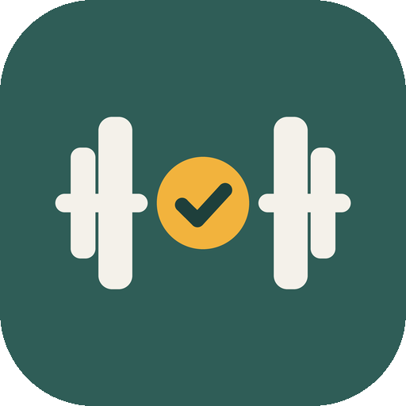

# Setlist

Setlist is a strength training log for one lifter on Android, built to replace FitNotes. The whole day sits on one screen, a docked panel edits the highlighted set, an edit to set 1 carries down to the later planned sets that held the same value, logging the last set of an exercise moves on without asking, each exercise card has a drag handle, and exercises grouped into a superset take turns. It works offline and keeps everything in one SQLite file on the phone.

`docs/design.md` says what the app does and why. `docs/architecture.md` says how the code is laid out.

## Install it on a phone

Install [Obtainium](https://github.com/ImranR98/Obtainium) and add `https://github.com/manuelschurr/setlist` to it. Obtainium watches this repository's releases and installs each new `setlist_<version>_android-arm64.apk`, after Android has asked once whether it may install apps. The APK is for phones with a 64-bit ARM processor, which nearly every phone of the last years has. You can also download the APK from the Releases page and open it.

Every release is signed with the same key, which is what lets a new version install over the old one and keep your data. A Setlist installed from any other build, signed with another key, has to be uninstalled first, and uninstalling deletes its data, so export a backup before you switch.

## Move your FitNotes history over

1. In FitNotes, open **Settings**, then **Backup**, then **Save Backup**, and save the file to Downloads.
2. In Setlist, open **History**, tap the **Data** menu, then **Import FitNotes backup**, and pick that file.

The import writes one Setlist set per FitNotes set and then lists what it left out, such as routines and comments on deleted sets. FitNotes superset groups arrive as supersets. Sets on past days arrive as done. For today and later days, FitNotes' completion checkbox decides. Running the import again is safe. It refreshes days you have not touched in Setlist and never changes a day you have saved in Setlist. Setlist before 0.3.0 left superset groups out, so importing the same backup again brings them to the days you have not changed in Setlist.

A Google Drive automatic backup from FitNotes arrives as a zip file. Unzip it first.

## Back up and restore

**History**, then **Data**, then **Google Drive backup** keeps a copy of everything on Google Drive without you having to remember it. Tap **Choose backup folder**. In the system picker, pick Drive, open **My Drive**, then pick a folder or create one, such as `Setlist backups`, and tap **Use this folder**, then **Allow**. My Drive itself can't be used. No Google sign-in in Setlist is needed, only the Drive app signed in on the phone.

From then on, each time you leave Setlist after a change, it writes the whole database over this week's file in that folder and hands it to the Drive app, which uploads it. Each week gets its own file, named by the Monday it starts, such as `Setlist week of 2026-11-09.sqlite`. Setlist never changes an earlier week's file, so a mistake can only reach this week's, and it never deletes one. Delete old files in Drive if you need the space.

The same screen shows when the last backup reached the folder and which file holds it, or why the last one failed. **Back up now** writes it at once. **Restore latest backup** replaces everything on the phone with the newest file, after a confirmation. **Restore an earlier week** opens the picker in the backup folder, so you can pick an older file. **Change folder** sends the backups to another folder. **Stop backing up** forgets the folder and leaves its files in Drive.

If you used Google Drive backup in Setlist 0.2 or 0.3, backups keep going to the file you chose then until you tap **Choose backup folder**. The old file stays in Drive.

On a new phone, install Setlist, open **History**, then **Data**, then **Restore Setlist backup**, and pick the newest weekly file in Drive. Then choose the backup folder again on the new phone, because the link belongs to the phone that made it.

**Export Setlist backup** saves a one-off copy wherever you choose, and **Restore Setlist backup** replaces everything with such a copy, after a confirmation. While a backup folder is linked, that picker opens in it. Every restore keeps the replaced database in Setlist's own storage as `setlist.sqlite.before-restore-<unix ms>`.

## Develop

`scripts/fl` runs `flutter` under a host-wide lock, because two Gradle builds at once run this 12 GB VPS out of memory. Use it for every Flutter command.

| Command | What it does |
| --- | --- |
| `scripts/fl test` | Runs every test: the day rules, the store, the importer and the screens. |
| `scripts/fl analyze` | Runs the analyzer. |
| `SETLIST_FITNOTES_BACKUP=<file> scripts/fl test test/fitnotes_test.dart` | Also imports a real FitNotes backup and checks one set per `training_log` row. |
| `SETLIST_RENDER_DIR=<dir> scripts/fl test test/render_screens_test.dart` | Draws the main screens to PNGs at the test phone's size, for layout review without a device. |
| `python3 tools/icon.py [preview-dir]` | Regenerates the launcher icon layers, `docs/icon.svg` and `docs/icon.png` from the shapes in the script, and writes launcher-shaped previews when given a folder. |
| `SETLIST_DEVICE=<host:port> scripts/device.py <command>` | Drives a phone over adb: `install`, `launch [package]`, `ui` (lists visible labels), `tap <label>`, `shot <file>`, `slide x1 y1 x2 y2 [file]` (a held drag, with a screenshot before the finger lifts). |

Debug builds install as a separate app, `de.schurr.setlist.debug`, labelled Setlist debug, so testing never touches the installed release or its data.

## Release

Run `tools/release-key.sh` once on the build machine. It makes the signing key in `~/.config/setlist/android`, outside the repository. Back that folder up somewhere other than the server: without it, no later release can update an installed Setlist.

`tools/release.sh 0.2.0` publishes version 0.2.0 from a clean `main`. It sets the version in `pubspec.yaml`, tags `v0.2.0`, builds the APK, checks that it carries the release key's signature, pushes, and attaches the APK to a GitHub release. Release notes come from `docs/releases/0.2.0.md` when that file exists, and are generated from the commits otherwise.

`docs/schema.sql` is the database schema as the migrations build it, and `test/store_test.dart` fails if the two differ. `docs/decisions.tsv` logs each design decision with its evidence.
